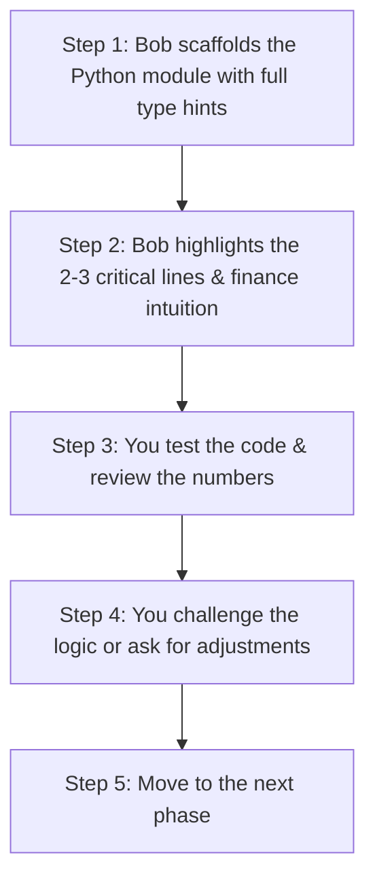

# 🎓 How to Learn & Collaborate with Bob on AI Agents in Finance

> **Purpose**: This guide helps you get the maximum educational value out of this practical project. The goal is not just to have working code, but to deeply understand the **financial mechanics**, **agentic design patterns**, and **production trade-offs**.

---

## 1. The Core Philosophy: AI-Assisted Learning

Working with Bob (or Claude / Groq / ChatGPT) is like pair-programming with a **Principal Quantitative AI Engineer**:

```
┌──────────────────────────────────────┐          ┌──────────────────────────────────────┐
│             YOUR FOCUS               │          │             BOB'S ROLE               │
│         (The Decision Maker)         │          │         (The Pair Engineer)          │
├──────────────────────────────────────┤          ├──────────────────────────────────────┤
│ 💡 Financial Intuition & Concepts    │ ◀──────▶ │ ⚙️ Clean Python Code & Scaffolding    │
│ 🏗️ Multi-Agent Architecture Design   │          │ 📜 Prompt Engineering & Schema Design│
│ 🎯 Analyzing Contradictions in Data  │          │ ⚡ Async & Caching Implementation    │
│ 🔍 Reviewing & Asking "Why?"         │          │ 🔬 Line-by-Line Code Breakdowns      │
└──────────────────────────────────────┘          └──────────────────────────────────────┘
```

---

## 2. Division of Labor: What to Learn vs. What to Ask Bob

| Area | What YOU Focus On (Your Learning) | What BOB Does (The Heavy Lifting) |
|---|---|---|
| **Data & Tools** | Understand why tools must return raw numbers (`98700000000`, not `"$98.7B"`) and why ratios use specific denominators. | Implements API parsers (`yfinance`), caching decorators (`@cache_tool_result`), and error handling. |
| **Financial Valuation** | Understand the DCF formula, why WACC is chosen (e.g. 9%), and what the Margin of Safety means. | Implements the deterministic math engine in `valuation_tools.py` with Gordon Growth equations. |
| **Agent Specialization** | Understand why we split tasks into 5 specialist agents rather than one giant prompt. | Writes system prompts, role definitions, and tool bindings in `agents/`. |
| **Orchestration** | Understand why Phase 1 runs in parallel while Phase 2 and 3 run sequentially. | Implements `asyncio.gather` and multi-phase orchestrator pipelines in `orchestrator.py`. |
| **The "Wow Moment"** | Interpret why the model gives **STRONG SELL** while news headlines are **BULLISH**. | Generates the clean executive brief and machine-readable JSON output. |

---

## 3. High-Value Questions to Ask Bob During the Project

Whenever we build a module, use these question prompts to test your understanding:

### On Finance Mechanics 📊
* *"Why did Apple's ROE come out at 171% while its Net Margin is only 27%?"*
  * **Answer to discover**: Share buybacks shrunk equity on the balance sheet, drastically reducing the denominator.
* *"Why is a Current Ratio below 1.0 not alarming for Apple or Microsoft?"*
  * **Answer to discover**: High quarterly operating cash flow and fast cash conversion cycles allow mega-cap tech to run negative working capital safely.
* *"How does the DCF model calculate Terminal Value?"*
  * **Answer to discover**: Using the Gordon Growth model: $\text{TV} = \frac{\text{FCF}_5 \times (1 + g)}{\text{WACC} - g}$.

### On Multi-Agent Engineering 🤖
* *"Why do we use in-memory caching for `get_balance_sheet` and `compute_key_ratios`?"*
  * **Answer to discover**: `FinancialDataAgent` and `RiskAgent` both inspect the balance sheet. Caching avoids duplicate network requests, keeping latency under 60 seconds.
* *"Why do we wrap agents with `.as_tool()` in the orchestrator?"*
  * **Answer to discover**: Allows the lead research director agent to treat subordinate agents as callable functions, receiving their structured summaries cleanly.
* *"Why does the LLM need structured JSON outputs instead of freeform paragraphs?"*
  * **Answer to discover**: Freeform text causes downstream tools to fail when parsing numbers for comparison tables.

---

## 4. The 4-Step Interactive Learning Flow

For each phase of the project, we follow this cycle:



---

## 5. Navigation & References

* [**`README.md`**](README.md): Quickstart commands and environment setup.
* [**`PROBLEM_STATEMENT.md`**](PROBLEM_STATEMENT.md): Detailed problem statement, architecture diagrams, and financial glossary.
* [**`PLAN.md`**](PLAN.md): Step-by-step implementation roadmap across Phases 1 through 4.
* [**`AI Agents in Finance.pdf`**](AI%20Agents%20in%20Finance.pdf): Course material and source slides.
