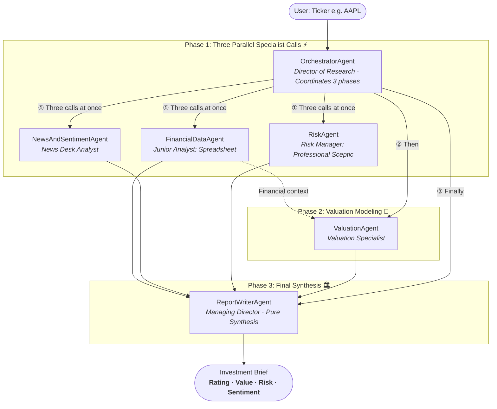

# Project Specification: 60-Second AI Fundamental Stock Analyst

---

## 1. Problem Statement

### The Manual Bottleneck
Conducting institutional-grade fundamental equity research on a single public company (e.g., Apple `AAPL`, Microsoft `MSFT`, Nvidia `NVDA`) manually takes an equity research analyst **2 to 3 hours** ($120–180$ minutes):

```
[1. Gather Data (30-45m)] ➡️ [2. Calculate Ratios (30m)] ➡️ [3. Qualitative/News/Moat (30m)] ➡️ [4. Valuation DCF (30m)] ➡️ [5. Report Synthesis (30m)]
```

* **Data Gathering (30–45 min)**: Pulling SEC 10-K/10-Q reports, balance sheets, income statements, and cash flows.
* **Financial Health & Ratios (30 min)**: Calculating historical margins, liquidity, leverage, and ROE/ROIC metrics.
* **Qualitative & News Research (30 min)**: Reading earnings calls, press releases, competitive dynamics, and analyst sentiment.
* **Valuation Modeling (30 min)**: Constructing 5-year Discounted Cash Flow (DCF), WACC estimates, terminal value, and sensitivity tables.
* **Investment Thesis Synthesis (30 min)**: Reconciling bull vs. bear arguments, identifying red flags, and assigning an investment rating.

### The Objective
Build an autonomous **Multi-Agent Equity Research Team in Code** that completes this entire 5-step workflow in **under 60 seconds**, generating a structured JSON data contract and a concise 1-page executive investment brief.

---

## 2. Core Project Requirements

### Requirement 1: The "JSON Rule" & Structured Output Contracts
* **Rule 1 (Tools Return JSON)**: Every tool function MUST return a valid JSON string. The LLM framework feeds tool results to models as plain text; formatted JSON guarantees unambiguous numerical parsing and prevents type errors or hallucination.
* **Final Machine-Readable Contract**: The system must export a comprehensive JSON object:

```json
{
  "ticker": "AAPL",
  "company_name": "Apple Inc.",
  "sector": "Technology",
  "current_price": 258.95,
  "verdict": {
    "rating": "STRONG SELL",
    "valuation_verdict": "SIGNIFICANTLY OVERVALUED",
    "risk_verdict": "ELEVATED RISK",
    "sentiment": "BULLISH",
    "intrinsic_value_dcf": 133.92,
    "upside_downside_pct": -48.3
  },
  "financial_health": {
    "revenue_cagr_3yr": 0.042,
    "gross_margin": 0.468,
    "net_margin": 0.269,
    "roe": 1.52,
    "current_ratio": 0.98,
    "quick_ratio": 0.84,
    "debt_to_equity": 1.81
  },
  "valuation_summary": {
    "pe_ratio": 36.2,
    "ev_to_ebitda": 26.4,
    "dcf_fair_value": 133.92,
    "peer_premium_pct": 38.6
  },
  "risk_flags": [
    "High valuation multiple relative to historical median",
    "High debt-to-equity ratio driven by aggressive share repurchases",
    "Concentration in smartphone segment & China supply chain dependencies"
  ]
}
```

* **Human Executive Brief**:
```text
================================================================================
FUNDAMENTAL ANALYSIS BRIEF
Apple Inc. (AAPL) | Technology
================================================================================

INVESTMENT VERDICT
  Valuation verdict (from ValuationAgent):  SIGNIFICANTLY OVERVALUED
  Risk verdict (from RiskAgent):             ELEVATED RISK
  Applying rating table =>                   STRONG SELL

  Sentiment:        BULLISH
  Intrinsic Value:  $133.92 per share (DCF)
  Current Price:    $258.95
  Upside/Downside:  -48.3%

FINANCIAL HEALTH
  - Revenue rose from $383,285M (2023) to $416,161M (2025)
  - Gross margin ~47%, net margin ~27%, ROE 152%

VALUATION ANALYSIS
  - DCF: $133.92 per share, 48.3% below the market price
  - Peers: trades at a 38.6% premium

... market sentiment, risk factors, bull / base / bear case, conclusion ...
This report is for educational purposes only. Not financial advice.
================================================================================
```

---

### Requirement 2: System Architecture Diagram (3-Phase Flow)



---

### Requirement 3: Shared Tool Architecture & In-Memory Caching

When multiple agents request identical underlying data, tools marked with `*` use **in-memory caching** to return instant results ($<1\text{ms}$) on subsequent calls without repeating expensive HTTP requests:

| Agent | Role | Assigned Tools |
|---|---|---|
| **`FinancialDataAgent`** | Junior Analyst | `get_income_statement`, `get_balance_sheet` *, `get_cash_flow_statement`, `compute_key_ratios` * |
| **`NewsAndSentimentAgent`** | News Desk | `search_recent_news` *, `analyze_sentiment` |
| **`RiskAgent`** | Risk Manager (The Sceptic) | `get_balance_sheet` * *(shared)*, `compute_key_ratios` * *(shared)*, `search_recent_news` * *(shared)* |
| **`ValuationAgent`** | Valuation Specialist | `run_dcf_model`, `get_peer_multiples` |
| **`ReportWriterAgent`** | Managing Director | *None (Pure Synthesis)* |
| **`OrchestratorAgent`** | Director of Research | Wraps the 5 specialist agents as tools (`.as_tool()`) |

#### Caching Decorator Pattern
```python
import functools

def cache_tool_result(func):
    """Caches tool responses so shared tools avoid redundant external fetches."""
    cache = {}
    @functools.wraps(func)
    def wrapper(*args, **kwargs):
        key = (func.__name__, args, frozenset(sorted(kwargs.items())))
        if key not in cache:
            cache[key] = func(*args, **kwargs)
        return cache[key]
    return wrapper
```

---

### Requirement 4: Directory Structure

```text
weekend-sessions-main/finance/
├── PROBLEM_STATEMENT.md      # Full specification, financial glossary & requirements
├── README.md                 # Quickstart guide, setup & how to run
├── requirements.txt          # Python dependencies
├── agents/                   # Agent definitions
│   ├── financial_data_agent.py   # Statements + ratios -> financial health verdict
│   ├── news_sentiment_agent.py   # Headlines -> sentiment verdict + risk flags
│   ├── risk_agent.py             # Sceptic: risk register + liquidity stress test
│   ├── valuation_agent.py        # DCF + peer multiples -> valuation verdict
│   ├── report_writer_agent.py    # Everything -> final investment brief (no tools)
│   └── orchestrator.py           # Runs the 3-phase workflow
├── tools/                    # Tool definitions (plain Python returning JSON)
│   ├── financial_tools.py        # 4 tools: 3 statements + compute_key_ratios
│   ├── valuation_tools.py        # 2 tools: run_dcf_model, get_peer_multiples
│   └── news_tools.py             # 2 tools: search_recent_news, analyze_sentiment
└── main.py                   # CLI entry point: python main.py AAPL
```

---

## 3. Financial & Market Terms Reference

### A. Market & Valuation Multiples

| Multiple | Formula | Intuition |
|---|---|---|
| **Price-to-Earnings (P/E)** | $\text{Share Price} \div \text{EPS}$ | Dollars paid for \$1 of annual net profit. |
| **Price-to-Book (P/B)** | $\text{Market Value} \div \text{Shareholders' Equity}$ | Price relative to the accounting net asset value. |
| **Price-to-Free-Cash-Flow** | $\text{Market Value} \div \text{FCF}$ | Real cash earnings multiple (avoids accounting distortions). |
| **Enterprise Value (EV)** | $\text{Market Cap} + \text{Total Debt} - \text{Cash}$ | Takeover price for the entire business. |
| **EV-to-EBITDA** | $\text{EV} \div \text{EBITDA}$ | Valuation of total business vs. operating cash earnings. |
| **EV-to-Sales** | $\text{EV} \div \text{Revenue}$ | How many years of top-line revenue the business costs. |

### B. Liquidity & Solvency Ratios

| Metric | Formula | Intuition |
|---|---|---|
| **Current Ratio** | $\text{Current Assets} \div \text{Current Liabilities}$ | Short-term assets per \$1 of bills due within 1 year ($>1.5\times$ is healthy). |
| **Quick Ratio (Acid Test)** | $(\text{Current Assets} - \text{Inventory}) \div \text{Current Liabilities}$ | Strict liquidity test excluding hard-to-sell inventory. |
| **Cash Ratio** | $\text{Cash \& Equivalents} \div \text{Current Liabilities}$ | Strictest test: cash alone vs. upcoming bills. |
| **Working Capital** | $\text{Current Assets} - \text{Current Liabilities}$ | Liquid dollar operating buffer. |
| **Debt-to-Equity (D/E)** | $\text{Total Debt} \div \text{Shareholders' Equity}$ | Financial leverage and reliance on debt. |
| **Interest Coverage** | $\text{EBIT} \div \text{Interest Expense}$ | How easily operating earnings cover interest payments. |

### C. Profitability & Capital Efficiency

| Metric | Formula | Intuition |
|---|---|---|
| **Gross Margin** | $(\text{Revenue} - \text{COGS}) \div \text{Revenue}$ | Pricing power and production efficiency. |
| **Operating Margin** | $\text{Operating Income} \div \text{Revenue}$ | Efficiency after R&D and SG&A expenses. |
| **Net Profit Margin** | $\text{Net Income} \div \text{Revenue}$ | Bottom-line profit percentage retained. |
| **Return on Equity (ROE)** | $\text{Net Income} \div \text{Equity}$ | Compounding efficiency on shareholder equity. |
| **Return on Invested Capital (ROIC)** | $\text{NOPAT} \div \text{Invested Capital}$ | Core moat indicator: return generated vs cost of capital. |

### D. DCF Intrinsic Valuation Model

| Concept | Definition | Formula / Implementation |
|---|---|---|
| **Free Cash Flow (FCF)** | Operational cash minus capital expenditures | $\text{Operating Cash Flow} - \text{CapEx}$ |
| **WACC** | Weighted Average Cost of Capital | Discount rate (typically 8.0%–10.0%) |
| **Terminal Value (TV)** | Value of all cash flows beyond year 5 | $\frac{\text{FCF}_5 \times (1 + g)}{\text{WACC} - g}$ where $g=2.5\%$ |
| **Intrinsic Value / Share** | Present value of FCF + TV minus net debt divided by shares | $\frac{\sum \text{PV}(\text{FCF}) + \text{PV}(\text{TV}) - \text{Net Debt}}{\text{Shares Outstanding}}$ |
| **Margin of Safety** | Percentage difference between fair value and market price | $\frac{\text{Intrinsic Value} - \text{Price}}{\text{Price}} \times 100\%$ |

---

## 4. Rating Matrix & The Class Discussion "Wow Moment"

### The Decision Matrix
The `ReportWriterAgent` maps the valuation verdict and risk verdict to determine the final rating:

| Valuation Verdict | Risk Verdict | Recommendation |
|---|---|---|
| Significantly Undervalued ($>25\%$ upside) | Low / Moderate Risk | **STRONG BUY** |
| Moderately Undervalued ($10–25\%$ upside) | Low / Moderate Risk | **BUY** |
| Fairly Valued ($-10\%$ to $+10\%$) | Any Acceptable Risk | **HOLD** |
| Moderately Overvalued ($10–25\%$ downside) | Any Risk Level | **SELL** |
| Significantly Overvalued ($>25\%$ downside) | Elevated / High Risk | **STRONG SELL** |

### The "Wow Moment"
> 💡 **Core Insight**: The system frequently produces **STRONG SELL** while market news sentiment is **BULLISH**.  
> Fundamentals may show the stock is mathematically overvalued relative to cash flows, while headlines celebrate current hype. The system's purpose is to lay both realities side-by-side with full transparency and traceable numbers.
